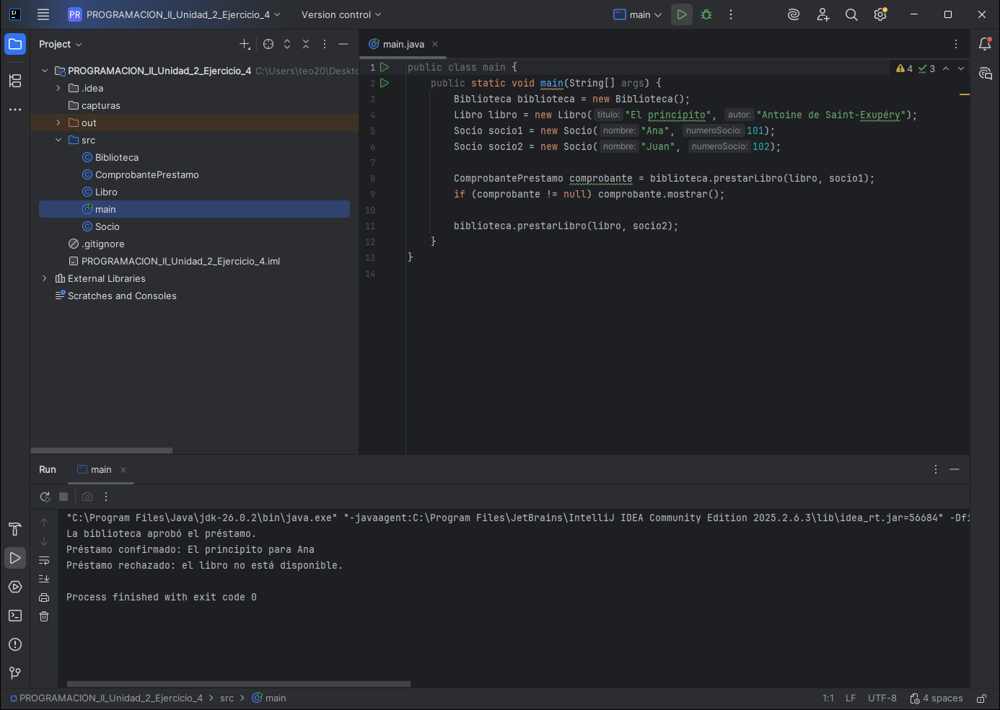

# PROGRAMACIÓN II — Unidad 2, Ejercicio 4: Biblioteca y Préstamo de Libros

Trabajo práctico de Programación II. Este repositorio contiene la resolución en Java del ejercicio 4 de la Unidad 2.

## Consigna

#### Contexto

Para gestionar el préstamo de ejemplares, un objeto Socio debe comunicarse con un objeto Bibliotecario o SistemaBiblioteca, solicitando un libro. El sistema valida las condiciones y responde si la operación es aceptada o rechazada.

#### Consigna

Implementar un sistema de comunicación bidireccional mediante mensajes donde el socio envía una solicitud de préstamo y el sistema de biblioteca procesa el mensaje y devuelve un comprobante u objeto de tipo Prestamo.

#### Desarrollo requerido

- Definir las clases Libro (con título, autor y disponibilidad) y Socio (con nombre y número de socio).
- Crear la clase Biblioteca que contenga un método prestarLibro(Libro libro, Socio socio) que evalúe si el libro está disponible.
- Asegurar que el método devuelva un objeto ComprobantePrestamo si la operación es exitosa, o null/excepción si no lo es.
- En el método main, crear instancias de libros, socios y la biblioteca, y ejecutar el flujo de mensajes para un préstamo exitoso y uno fallido.

## Estructura del repositorio

```
PROGRAMACION_II_Unidad_2_Ejercicio_4/
├── README.md
├── capturas/
│   └── consola.png
└── src/
    ├── Biblioteca.java
    ├── ComprobantePrestamo.java
    ├── Libro.java
    ├── main.java   # clase con el método main
    └── Socio.java
```

## Funcionamiento y lógica

El ejercicio modela un préstamo de biblioteca en el que intervienen varios objetos que colaboran entre sí.

### `Libro`

Tiene `titulo`, `autor` y `disponible` (privados). Todo libro nuevo empieza disponible. Con `estaDisponible()` y `setDisponible()` se consulta y se cambia su estado.

### `Socio`

Guarda el `nombre` y el `numeroSocio` del lector.

### `ComprobantePrestamo`

Se crea cuando el préstamo se aprueba. Guarda el libro y el socio involucrados, y con `mostrar()` imprime qué libro se prestó y a quién.

### `Biblioteca`

Su método `prestarLibro(Libro, Socio)` consulta si el libro está disponible:

- Si lo está, lo marca como no disponible y **devuelve** un `ComprobantePrestamo`.
- Si no, informa que el préstamo fue rechazado y devuelve `null`.

### `main`

Crea la biblioteca, el libro "El principito" y dos socios (Ana y Juan).

1. Ana pide el libro → se aprueba y se muestra el comprobante. Antes de mostrarlo se verifica que no sea `null`.
2. Juan pide el mismo libro → se rechaza porque ya está prestado.

## Ejecución

Captura de la consola de IntelliJ IDEA ejecutando el programa:



Salida obtenida:

```
La biblioteca aprobó el préstamo.
Préstamo confirmado: El principito para Ana
Préstamo rechazado: el libro no está disponible.
```
